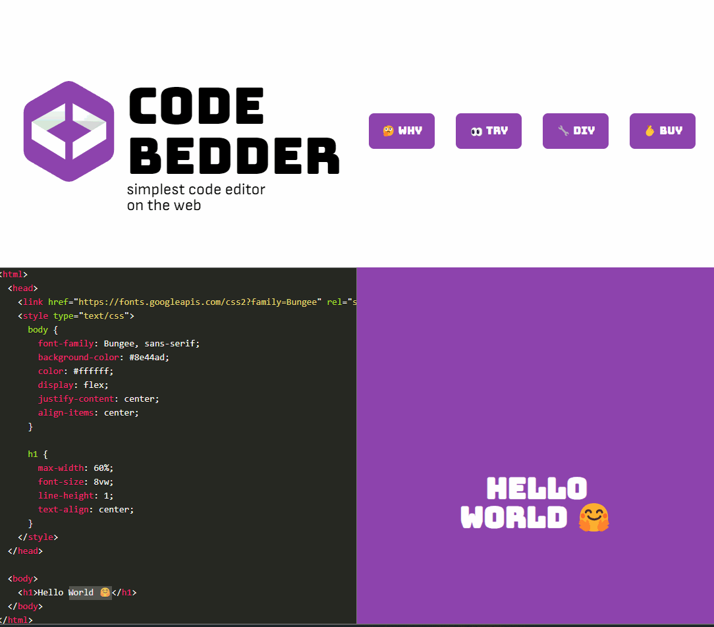

# CodeBedder

A `<code-bedder>` web component: a transparent `<textarea>` over a syntax-highlighted `<pre><code>`. Bring your own highlighter (e.g. [PrismJS](https://prismjs.com), [highlight.js](https://highlightjs.org)).

## Usage

```html
<link href="prism.css" rel="stylesheet" />

<code-bedder data-language="html" onhighlight="Prism.highlightElement(this)">
&lt;h1&gt;Hello World&lt;/h1&gt;
</code-bedder>

<script src="prism.js"></script>
<script src="codebedder.js"></script>
```

The text content is the initial code (escape HTML; one leading newline is ignored).

| Attribute       | Description                                           |
| --------------- | ----------------------------------------------------- |
| `data-language` | `language-*` class on `<code>`. Default `html`.       |
| `onhighlight`   | Runs on every change, with `this`/`code` as `<code>`. |
| `name`          | Form value; `disabled` and form reset work too.       |
| `placeholder`   | Placeholder text.                                     |
| `readonly`      | Read-only.                                            |
| `aria-label`    | Accessible label.                                     |
| `line-numbers`  | `off` hides line numbers.                             |

```js
const editor = document.querySelector('code-bedder');
editor.value = 'const a = 1;'; // also works before rendering
editor.on('input', () => console.log(editor.value));
editor.on('load', () => editor.textarea.focus()); // runs immediately if already loaded
editor.onhighlight = (code) => hljs.highlightElement(code); // instead of the attribute
```

`<script src="codebedder.js" data-manual>` skips auto-registration; then `CodeBedder.register('my-editor')`.

## Styling

Size, borders etc. can be set on the element directly. Text metrics and colors use these variables, settable on any ancestor. Set the background via the variable so line numbers match:

| Variable                                         | Default                          |
| ------------------------------------------------ | -------------------------------- |
| `--code-bedder-font-family`                      | `Consolas, Monaco, …, monospace` |
| `--code-bedder-font-size`                        | `14px`                           |
| `--code-bedder-line-height`                      | `1.5`                            |
| `--code-bedder-tab-size`                         | `2`                              |
| `--code-bedder-padding`                          | `1em`                            |
| `--code-bedder-background`                       | `hsl(70, 8%, 15%)`               |
| `--code-bedder-caret-color`                      | `#ffffff`                        |
| `--code-bedder-placeholder-color`                | `hsla(0, 0%, 100%, 0.4)`         |
| `--code-bedder-selection-background`             | `hsla(0, 0%, 100%, 0.2)`         |
| `--code-bedder-line-number-color`                | `hsla(0, 0%, 100%, 0.35)`        |
| `--code-bedder-line-number-background`           | `var(--code-bedder-background)`  |
| `--code-bedder-scrollbar-size`                   | `0.5rem`                         |
| `--code-bedder-scrollbar-radius`                 | `0.25rem`                        |
| `--code-bedder-scrollbar-track-background`       | `hsl(215, 19%, 35%)`             |
| `--code-bedder-scrollbar-thumb-background`       | `hsl(215, 16%, 47%)`             |
| `--code-bedder-scrollbar-thumb-hover-background` | `hsl(215, 20%, 65%)`             |

## Development

```sh
npm install
npm test           # Chromium desktop + mobile
npm run test:all   # + Firefox, WebKit (needs `npx playwright install`)
npm run serve      # http://localhost:4173
```
